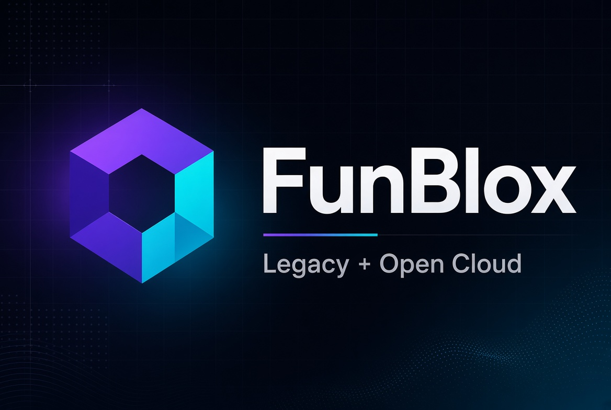

# FunBlox.js

Roblox API wrapper for Node.js (TypeScript).

Supports **legacy cookie-based APIs** (`*.roblox.com`) and **Open Cloud** (`apis.roblox.com`).

> Original: [mybot-rblx/FunBlox.js](https://github.com/mybot-rblx/FunBlox.js)  
> Authors: Fede1212156 / @fedeetide & Joshuadl12

---

## Install

```bash
npm i funblox.js
```

## Quick start

```js
const roblox = require("funblox.js");

// Legacy (cookie)
await roblox.setCookie("_|WARNING:-DO-NOT-SHARE-THIS...|_");

// Open Cloud (API key)
roblox.setOpenCloudKey(process.env.ROBLOX_CLOUD_KEY);
```

---

## Authentication

### Legacy — `.ROBLOSECURITY` cookie

Required for most `*.roblox.com` endpoints (groups rank changes, etc.).

```js
const { setCookie } = require("funblox.js");

await setCookie("_|WARNING:-DO-NOT-SHARE-THIS.--Sharing-this-will-allow-someone-to-log-in-as-you-and-to-steal-your-ROBUX-and-items.|_");
```

### Open Cloud — API key (recommended)

Create a key in the [Creator Dashboard → API Keys](https://create.roblox.com/dashboard/credentials?activeTab=ApiKeysTab).

```js
const { setOpenCloudKey, OpenCloudClient } = require("funblox.js");

// Default client
setOpenCloudKey(process.env.ROBLOX_CLOUD_KEY);

// Or your own instance
const cloud = new OpenCloudClient({
  apiKey: process.env.ROBLOX_CLOUD_KEY,
  // accessToken: "oauth-bearer-token", // optional OAuth
});
```

You can use both in the same process.

---

## Dual mode (legacy vs Open Cloud)

Many group and user functions accept an optional options object:

```js
const { getGroup, getRoles, setRank, promote, demote, getUser } = require("funblox.js");

// Legacy (cookie)
const group = await getGroup(123456);

// Open Cloud
const groupCloud = await getGroup(123456, { useOpenCloud: true });
const roles     = await getRoles(123456, { useOpenCloud: true });
const user      = await getUser(15671158, { useOpenCloud: true });

// Rank change without cookie / CSRF
await setRank(123456, 987654, 111222, { useOpenCloud: true });
await promote(123456, 987654, { useOpenCloud: true });
await demote(123456, 987654, { useOpenCloud: true });
```

| Function | Open Cloud option | Notes |
|----------|-------------------|-------|
| `getGroup` | `{ useOpenCloud: true }` | Uses `/cloud/v2/groups/{id}` |
| `getRoles` | `{ useOpenCloud: true }` | Uses `/cloud/v2/groups/{id}/roles` |
| `getUser` | `{ useOpenCloud: true }` | Uses `/cloud/v2/users/{id}` |
| `setRank` | `{ useOpenCloud: true }` | Assigns role via membership |
| `promote` / `demote` | `{ useOpenCloud: true }` | Forwards the flag |

**Typical scopes:** `group:read`, `group:write` (for role changes).

---

## Open Cloud methods

```js
const { opencloud } = require("funblox.js");

// Universes & messaging
await opencloud.getUniverse(123456789);
await opencloud.publishMessage(123456789, "announcements", "Hello from FunBlox!");

// Data stores
await opencloud.listDataStores(123456789);
await opencloud.getDataStoreEntry(123456789, "Inventory", "user_42");
await opencloud.setDataStoreEntry(123456789, "Inventory", "user_42", { coins: 100 });

// Users
await opencloud.getUser(15671158);

// Groups
await opencloud.getGroup(123456);
await opencloud.listGroupRoles(123456);
await opencloud.listGroupMemberships(123456);
await opencloud.assignRole(123456, "membership-id", 111222);
await opencloud.unassignRole(123456, "membership-id", 111222);
await opencloud.setRank(123456, 987654, 111222);
await opencloud.listJoinRequests(123456);
await opencloud.acceptJoinRequest(123456, 987654);
await opencloud.declineJoinRequest(123456, 987654);

// Any Open Cloud path
await opencloud.request("/cloud/v2/universes/123456789/places/987654321");
```

---

## Legacy methods

### Users

```js
const { getUser, getPlayerThumbnail, getUserFavoriteGames, getGroups } = require("funblox.js");

await getUser("username");          // or numeric id
await getUser(15671158);
await getPlayerThumbnail(15671158, "420x420", "Png", false);
await getUserFavoriteGames(15671158);
await getGroups(15671158);
```

### Groups

```js
const { getGroup, getRoles, setRank, promote, demote, getGroupGames, getGroupWall } = require("funblox.js");

await getGroup(123456);
await getRoles(123456);
await setRank(123456, 987654, 111222);   // requires cookie
await promote(123456, 987654);           // requires cookie
await demote(123456, 987654);            // requires cookie
await getGroupGames(123456);
await getGroupWall(123456);
```

### Games / Catalog

```js
const { getPlaceInfo, getGameVotes, getUniverseId, getCategories } = require("funblox.js");

await getPlaceInfo(123456);
await getGameVotes(123456);
await getUniverseId(123456);
await getCategories();
```

---

## TypeScript

```ts
import {
  setCookie,
  setOpenCloudKey,
  getGroup,
  opencloud,
  OpenCloudClient,
  type DualModeOptions,
} from "funblox.js";

const opts: DualModeOptions = { useOpenCloud: true };
const group = await getGroup(123456, opts);
```

---

## Notes

- Prefer **Open Cloud** for production when an endpoint exists — it has stronger stability guarantees.
- Cookie-based APIs can break without notice and have tighter rate limits.
- Always respect `Set-Cookie` updates from Roblox.
- This is an unofficial wrapper, not affiliated with Roblox.

## License

MIT
